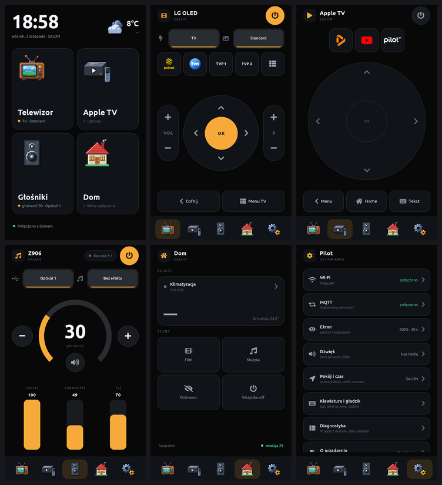
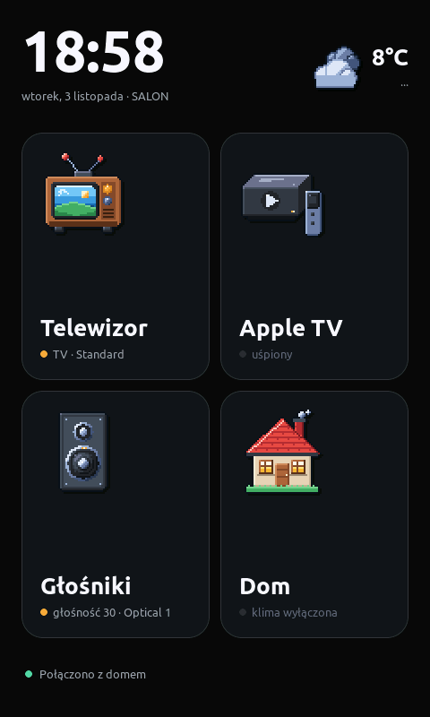
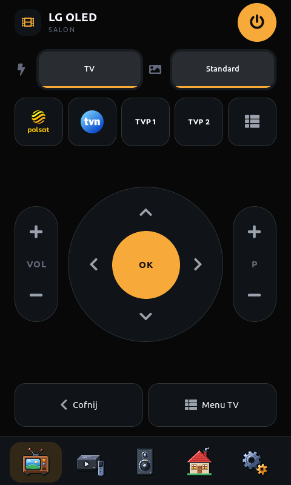
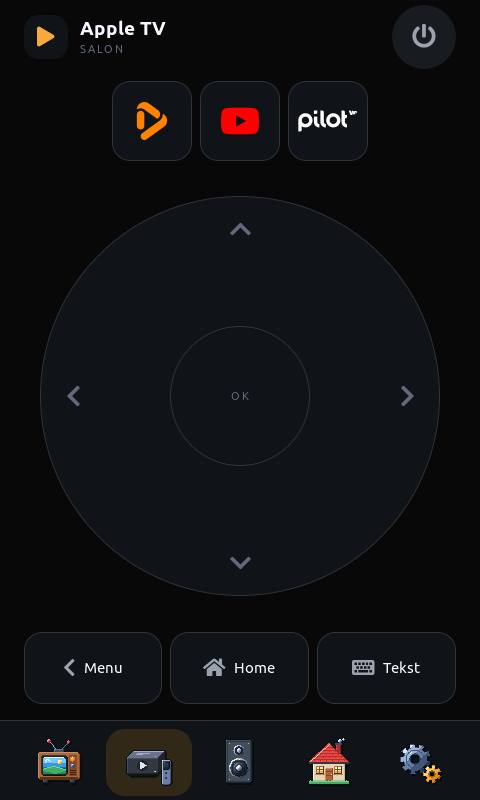
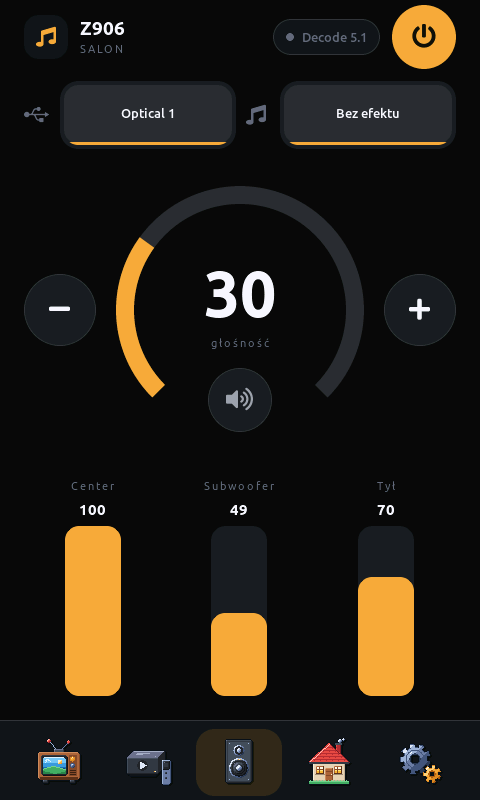
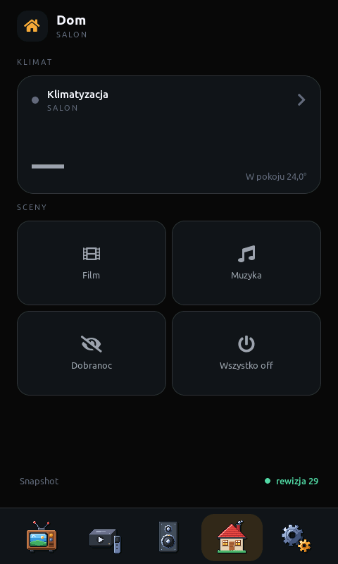
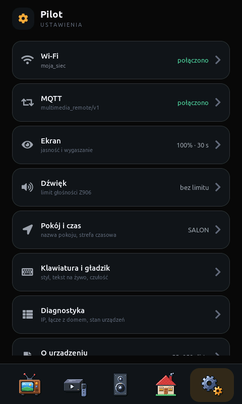
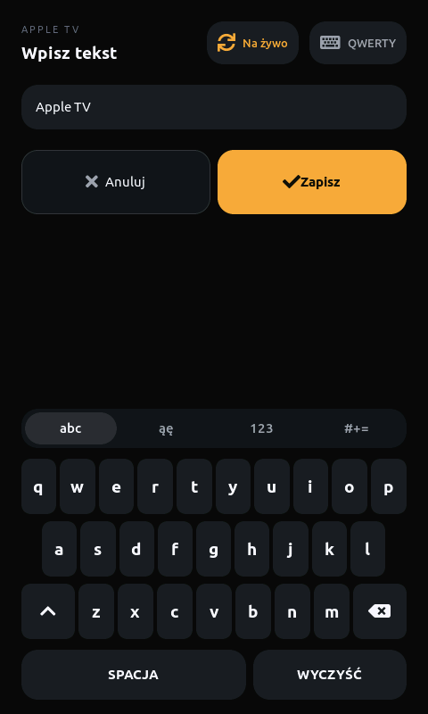
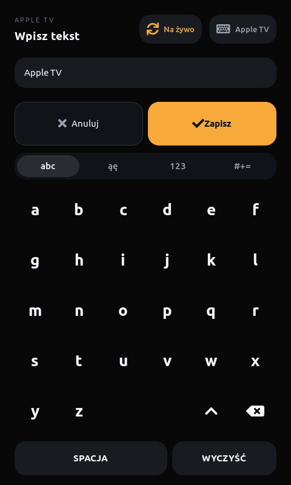

# Couchpad — dotykowy pilot do TV, Apple TV, Logitech Z906 i Home Assistanta

[English](README.md)

Natywny firmware dla 4,3-calowego panelu dotykowego z ESP32-P4, który steruje salonem po
MQTT: telewizorem LG, Apple TV, głośnikami Logitech Z906 i klimatyzacją przez Home
Assistanta. ESP-IDF, C++17 i LVGL 9 — bez przeglądarki na urządzeniu, więc pilot budzi się
w około dwie sekundy i reaguje od razu.



| Start | TV | Apple TV |
| --- | --- | --- |
|  |  |  |
| **Głośniki (Z906)** | **Dom** | **Ustawienia** |
|  |  |  |
| **Klawiatura Apple TV — QWERTY** | **Klawiatura Apple TV — układ Apple TV** | |
|  |  | |

## Co potrafi

- **TV** — stan zasilania, źródło i tryb obrazu, krzyżak, kołyski głośności i kanałów,
  cztery skróty kanałów z logo i lista wszystkich kanałów tunera.
- **Apple TV** — kafelki aplikacji, Menu/Home i okrągły gładzik działający jak pilot Siri:
  stuknięcie w strzałkę lub środek to jedno naciśnięcie, a przeciągnięcie palcem w dowolnym
  miejscu koła przewija listę krok po kroku, dopóki palec się porusza (czułość
  w ustawieniach).
- **Ukryte gesty pilota Siri** — te same co na oryginalnym pilocie: Home ×2 otwiera
  przełącznik aplikacji, przytrzymanie Home — Centrum sterowania, przytrzymanie środka
  gładzika — menu kontekstowe ikony ([szczegóły](docs/integrations/appletv.md)).
- **Klawiatura Apple TV** — wysuwa się sama, gdy na Apple TV pojawi się pole tekstowe (wyszukiwanie,
  logowanie), wpisuje tekst na żywo w trakcie pisania (także polskie znaki) i otwiera się też
  przyciskiem **Tekst**. Dwa układy: QWERTY albo alfabetyczna siatka znana z Apple TV,
  przełączane na samej klawiaturze lub w ustawieniach. Korzysta z `apple_tv.set_keyboard_text`
  i czujnika `keyboard_focus` w Home Assistancie ([ADR 0007](docs/architecture/adr/0007-apple-tv-via-home-assistant.md)).
- **Z906** — tarcza głośności z krokiem −/+, poziomy centralnego, subwoofera i tyłu,
  wejście i efekt, wskaźnik Decode 5.1.
- **Dom** — klimatyzacja (tryb, temperatura, nawiew, żaluzje) i sceny.
- **Ekran startowy** po wybudzeniu — zegar, pogoda i stan każdego urządzenia.
- **Ustawienia na urządzeniu** — Wi-Fi, broker MQTT, ekran, limit głośności, pokój i strefa
  czasowa, klawiatura i gładzik, diagnostyka. Dane dostępowe wpisuje się na panelu i leżą
  w jego NVS, nigdy w repozytorium.

Pilot nigdy nie pokazuje starego stanu jako aktualnego: po wybudzeniu prosi o świeży snapshot
i do tego czasu wygasza kontrolki
([ADR 0005](docs/architecture/adr/0005-fresh-state-after-wake.md)).

## Sprzęt

| Element | Uwagi |
| --- | --- |
| [Guition JC4880P443C_I_W (ESP32-P4 + ESP32-C6, 4,3" IPS 480×800, dotyk, obudowa)](https://pl.aliexpress.com/item/1005009675498892.html) | ESP32-P4 uruchamia aplikację, ESP32-C6 daje Wi-Fi po SDIO. Piny i timingi sprawdzone na egzemplarzu: [docs/hardware/verified-board-map.md](docs/hardware/verified-board-map.md) |
| Kabel USB-C | zasilanie, wgrywanie, log, zrzuty ekranu |

Kamera z zestawu nie jest używana.

## Kto z kim rozmawia

```text
                       ┌── Glasshouse na telewizorze LG  (stan TV i przyciski)
pilot ── broker MQTT ──┼── kontroler Z906 (ESP32)        (głośniki, tematy wprost)
                       └── Home Assistant ── Apple TV, klima, pogoda, przełączanie kanałów
```

| Urządzenie | Integracja | Droga |
| --- | --- | --- |
| Telewizor LG (webOS) | [Glasshouse](https://github.com/rorygallagher2024/glasshouse) na telewizorze | MQTT wprost; skróty kanałów przez Home Assistanta, który woła Glasshouse po HTTP ([ADR 0008](docs/architecture/adr/0008-tv-via-glasshouse.md)) |
| Logitech Z906 | kontroler ESP32 na bazie [ggroohauga](https://github.com/nomis/ggroohauga), zmodyfikowany o MQTT | MQTT wprost, tematy `z906/<id>/…` ([ADR 0006](docs/architecture/adr/0006-direct-z906-topics.md)) |
| Apple TV | integracja `apple_tv` w Home Assistancie | kontrakt `multimedia_remote/v1` przez pakiet HA ([ADR 0007](docs/architecture/adr/0007-apple-tv-via-home-assistant.md)) |
| Klimatyzacja | dowolna encja `climate` w HA | ten sam kontrakt ([ADR 0009](docs/architecture/adr/0009-climate-via-home-assistant.md)) |
| Pogoda | dowolna encja `weather` w HA | ten sam kontrakt ([ADR 0011](docs/architecture/adr/0011-weather-on-start-screen.md)) |

Pełny format wiadomości: [docs/architecture/mqtt-contract.md](docs/architecture/mqtt-contract.md).
Każda integracja jest opcjonalna: ekran bez źródła pokazuje pasek „brak świeżego stanu”.

## Budowanie i wgrywanie

Potrzebny [ESP-IDF v5.5](https://docs.espressif.com/projects/esp-idf/en/v5.5/esp32p4/get-started/)
(testowane na v5.5.6). Wersje komponentów są przypięte w `main/idf_component.yml`.

```bash
. ~/esp/esp-idf/export.sh
idf.py build
idf.py -p /dev/cu.usbmodem101 flash monitor
```

Port podaj swój. Przed pierwszym wgraniem warto zrobić kopię firmware'u fabrycznego:
`esptool.py --port <port> read_flash 0 0x1000000 backup.bin`.

## Pod siebie

### 1. Na urządzeniu (bez zmian w kodzie)

Otwórz **Ustawienia** (zakładka z kołami zębatymi):

1. **Wi-Fi** — wybierz sieć i wpisz hasło.
2. **MQTT** — adres brokera, port, użytkownik i hasło, identyfikator pilota (tworzy temat
   `multimedia_remote/v1/<identyfikator>`), identyfikator kontrolera Z906 (`z906_<mac>`)
   i prefiks tematów Glasshouse.
3. **Pokój i czas** — nazwa pokoju w nagłówkach, strefa czasowa.

Załóż pilotowi osobne konto MQTT.

### 2. Home Assistant

Zainstaluj pakiet z [homeassistant/](homeassistant/README.md): skopiuj
`multimedia_remote.yaml` do `packages/`, podmień przykładowe encje na swoje, ustaw
identyfikator pilota, a adres i token Glasshouse wpisz do `secrets.yaml`.

### 3. Kontroler Z906

Pilot oczekuje jednej wartości na temat w `z906/<id>/state/<nazwa>` i wysyła polecenia na
`z906/<id>/command/<nazwa>` — pełna tabela jest w
[ADR 0006](docs/architecture/adr/0006-direct-z906-topics.md). Jeśli Twój kontroler publikuje
inaczej, dostosuj `components/transport/z906_client.cpp`.

### 4. W kodzie

| Co | Gdzie |
| --- | --- |
| Skróty kanałów (nazwy tak, jak podaje je tuner) | `kChannelIds` w `components/ui/screens/screen_tv.cpp` |
| Logo kanałów i aplikacji | SVG w `docs/ux/mockup-pulpit/assets/`, rozmiary w `tools/gen_assets.py`, potem `./tools/gen-assets.sh` |
| Kafelki aplikacji Apple TV (bundle id) | `components/domain/include/domain/appletv_apps.hpp` i `atv_favourites` w pakiecie HA |
| Nazwy urządzeń w nagłówkach („LG OLED”, „Z906”) | `kScreens` w `components/ui/shell.cpp` |
| Domyślna nazwa pokoju i strefa czasowa | `components/storage/settings.cpp` |
| Teksty interfejsu | `components/ui/screens/*.cpp` |

## Narzędzia deweloperskie

- **Konsola USB** (`CONFIG_PILOT_USB_CONSOLE`, domyślnie włączona): zrzuty ekranu i zdalny
  dotyk po kablu.

  ```bash
  uvx --with pyserial --with pillow python tools/remote.py shot ekran.png
  uvx --with pyserial --with pillow python tools/remote.py tour zrzuty/
  ```

  `tour` dotyka wyłącznie paska zakładek. Ekran ustawień pokazuje nazwę Twojej sieci Wi-Fi —
  zamaskuj ją przed publikacją zrzutu.
- **Log przez MQTT** (`CONFIG_PILOT_REMOTE_LOG`, domyślnie wyłączony): `tools/pilot_log.py`.
- **Interaktywna makieta** całego interfejsu: `docs/ux/mockup-pulpit/index.html`.

## Dokumentacja

[Architektura i ADR](docs/architecture/README.md) ·
[architektura UI](docs/architecture/ui-architecture.md) ·
[uruchomienie płytki](docs/hardware/bring-up.md) ·
[integracje](docs/integrations/) ·
[zasady dla osób i agentów AI](AGENTS.md).

## Licencja

[MIT](LICENSE) dla kodu w tym repozytorium. Dołączone elementy zewnętrzne mają własne
licencje:

- `components/board_bsp` — BSP Espressifa, Apache-2.0 (`components/board_bsp/LICENSE`)
- `components/esp_lcd_st7701_patched` — sterownik ST7701 Espressifa z łataną sekwencją
  startową, Apache-2.0 (`license.txt`)
- krój Ubuntu w `components/ui/assets/fonts` — Ubuntu Font Licence 1.0
- znaki Infuse i YouTube z [Simple Icons](https://simpleicons.org) (CC0)

Logo kanałów i aplikacji (Polsat, TVN, TVP, WP Pilot, Infuse, YouTube) są znakami
towarowymi ich właścicieli i służą wyłącznie do oznaczenia skrótów.
