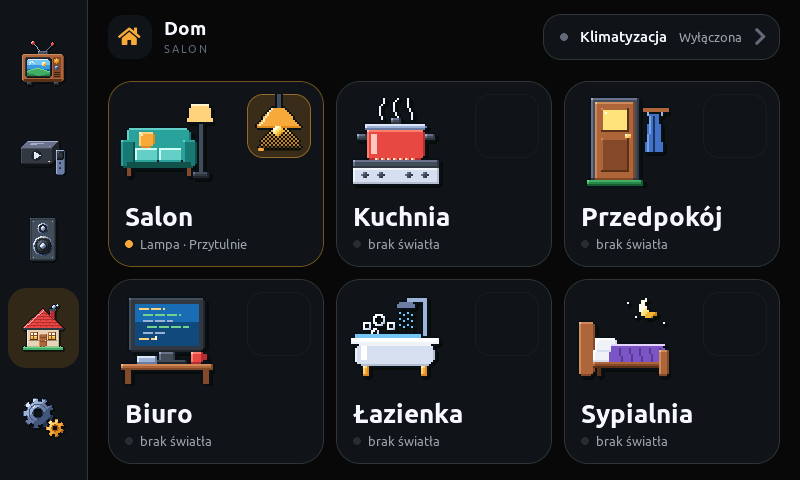
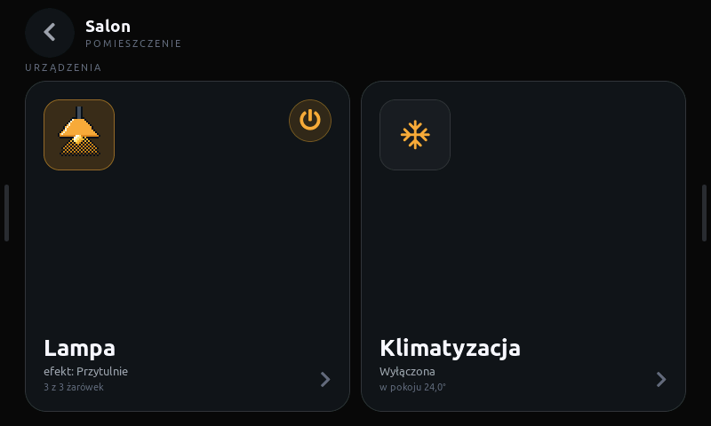
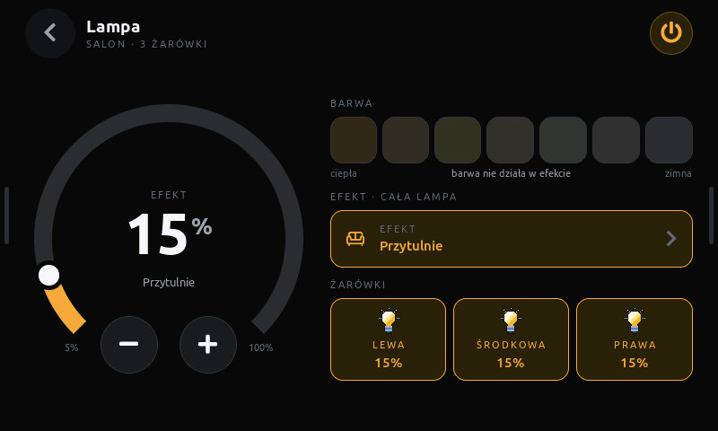
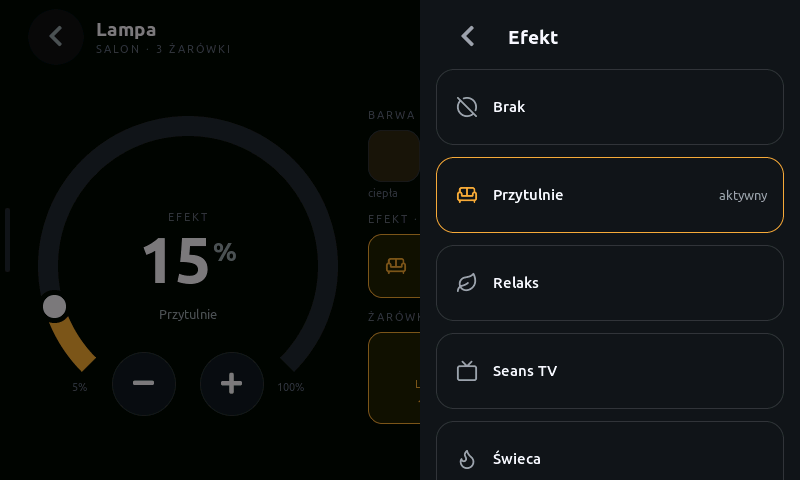
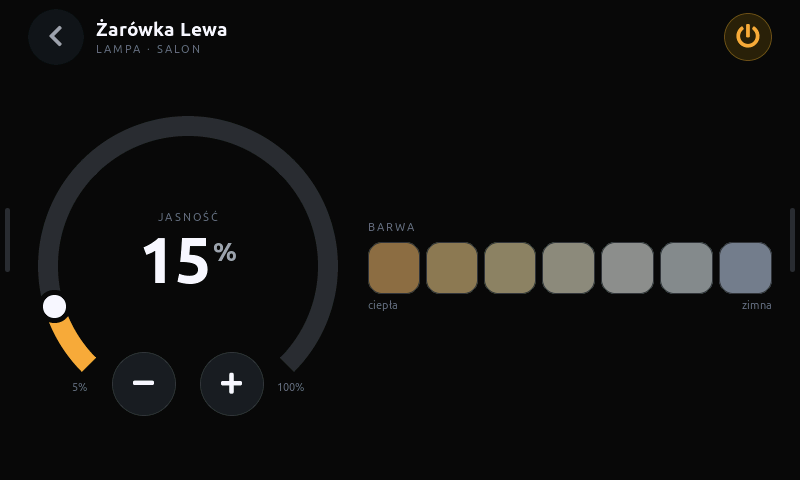
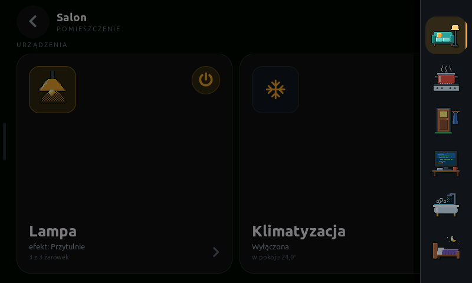
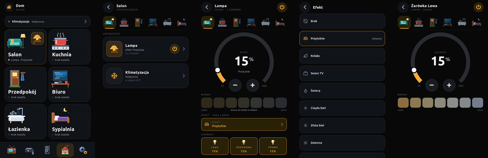
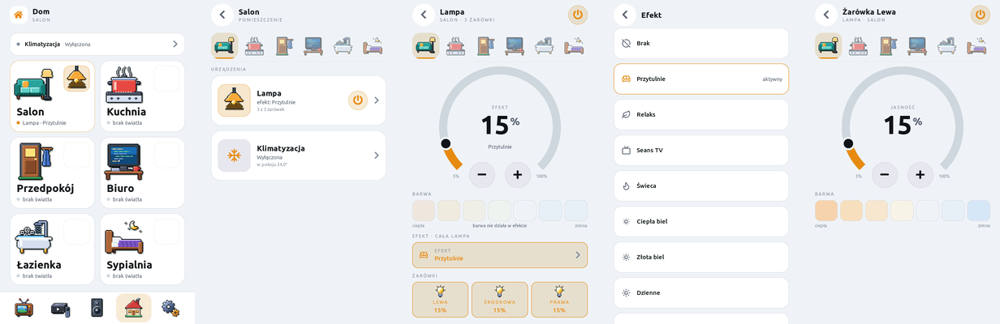

# Home tab standard

[Polski](home-screen.md)

The Home tab holds everything in the house that is not the TV, the Apple TV or the
speakers: lights, air conditioning, and later blinds, sensors, sockets and more rooms. This
document is a **standard**: a new Home-tab element picks its patterns from here instead of
inventing its own. Architectural decisions are in
[ADR 0014](../architecture/adr/0014-rooms-and-lights.en.md), the data format in the
[MQTT contract](../architecture/mqtt-contract.en.md) (`lights` section).

Mockups: [`mockup-pulpit`](mockup-pulpit/index.html) (portrait),
[`mockup-landscape`](mockup-landscape/index.html) (landscape), shared logic
[`mockup-dom/rooms.js`](mockup-dom/rooms.js) and [`rooms.css`](mockup-dom/rooms.css).
Code: `components/ui/screens/screen_home.cpp`.

| Home | Room | Lamp |
| --- | --- | --- |
|  |  |  |
| **Effect list** | **Bulb** | **Drawers (landscape)** |
|  |  |  |

Portrait (dark and light):





## 1. Hierarchy

```text
Home (room grid)
 └─ Room (the room's devices as cards)
     └─ Device screen (one device: Lamp, Air conditioning…)
         ├─ Sub-device (a bulb in a group)
         └─ Picker (effect, mode, fan speed…) — not a level, a sliding panel
```

- **Home** always shows every room, including rooms with no configured devices.
- **Room** shows the room's devices. A room without devices says so (a "No entities" card);
  it does not disappear.
- **Device screen** covers one device or one group. Full control lives here.
- **Never deeper than a sub-device.** Anything that is a choice from a list opens as a picker
  (4.6), not as another level.
- **Back** always goes up one level; from a room it returns to Home.

## 2. Rules

1. **Power in the header, on the right.** On a single-device screen the power button always
   sits in the top-right corner of the header (like TV, Z906, Apple TV, A/C). A room has
   several devices, so its header has no power button.
2. **Shortcuts only in lists.** A quick on/off without going deeper is allowed on the room
   tile (the lamp) and on the device card inside a room. A device screen has no shortcut —
   it has the header power button.
3. **One big control, tiles next to it.** A device screen has one dominant control
   (brightness dial, temperature dial) and uniform tiles with the remaining options next to
   it. Landscape: control on the left (320 px), tiles on the right. Portrait: control on top,
   tiles below. Nothing repeats: the device name is in the header, not again on a card.
4. **A picker instead of tiles when there are many options.** More than seven options or
   long names → a tile with the current value; tapping opens a picker. **Choosing closes the
   picker**; the pending state shows on the tile.
5. **The remote does not know entities.** The Home Assistant bridge sends short ids
   (`lampa`, `lampa_lewa`) and the remote controls them. A new entity is a bridge change,
   not a firmware change (as long as it fits an existing device type).
6. **The remote picks Polish names.** HA ids (`cool`, `Cozy`) are translated by a firmware
   table; an unknown id is shown as received — never hidden.
7. **Touch never waits for the network.** After a tap the element shows a pending state
   (outline); only a snapshot from HA changes the state. Without fresh state the element is
   dimmed and says "no fresh state" / "waiting for state" instead of guessing.
8. **Both layouts.** Every new screen has a portrait (480 × 800) and a landscape (800 × 480)
   version, first in the mockups, then in firmware.
9. **Icons:** rooms and devices — pixel art (`tools/draw_room_icons.py`, 48 or 32 grid,
   integer scale 1×/2×). Options (modes, effects) — Lucide 0.460.0 as a font
   (`tools/gen-fonts.sh`).
10. **Captions in capitals** (`make_cap`), Polish letters included: labels from HA go
    through `upper_pl` ("Środkowa" → "ŚRODKOWA").

## 3. Screen layouts

### Home

- Room grid: portrait 2 × 3, landscape 3 × 2; tiles fill the height.
- Air conditioning above the grid: portrait — a slim strip (56 px), landscape — a pill in the
  shell header. Any new whole-house device goes to the same place (strip / pill), not as an
  extra tile in the grid.

### Room

- Header: Back, room name, caption `POMIESZCZENIE`.
- Room rail (48 px icons, no lamps) switches rooms without going back: under the header in
  portrait, in the right drawer in landscape.
- Under the `URZĄDZENIA` caption, device cards: portrait — stacked (124 px), landscape — side by
  side at full height.

### Device screen

- Header: Back, device name, caption `ROOM · DETAIL` in capitals, power on the right.
- Content per rule 3.

### Landscape: drawers

In a room and deeper the content uses the whole 800 × 480 screen. The tab rail and the room
rail are hidden:

- a swipe from the left edge (28 px strip, ≥ 36 px of travel) slides in the tabs, from the
  right — the rooms; tapping the edge strip opens them too (5 × 64 px handles hint at them);
- tapping the dimmed background or swiping back to the edge closes the drawer;
- choosing a room or a tab closes the drawer by itself.

## 4. Components

### 4.1 Room tile

- `tile` card, radius r4. Room icon 96 px (48 pixel art × 2) top-left, name `b26` and a state
  row (dot + `r13`) at the bottom.
- **Lamp** in the top-right corner: a 64 × 64 button, a 64 px lamp image in four states (lit
  ≥ 50 %, dimmed, off, unavailable) and a 3 px brightness bar at the bottom. Background: lit —
  accent 92/255, dimmed — 46/255, off — `surface-2`. A room without a main light: outline only.
- Main light on: the tile outline turns accent (opa 110).
- State text: `Lampa · 62%`, `Lampa · Przytulnie`, `Lampa · wył.`, `brak światła`,
  `czekam na stan`.

### 4.2 Device card in a room

- 80 px well (device icon), name, state, a second detail line, chevron.
- Power shortcut (rule 2) only for devices that have one (lights).
- Well and texts: portrait — in a row, landscape — well on top, name at the bottom.

### 4.3 Dial

`widgets::Thermostat`: a 270° arc, a big number (`b64num`), a caption above it (state:
`JASNOŚĆ`, `EFEKT`, `WYŁĄCZONA`, A/C mode), detail below it, −/+ in the arc gap, scale at the
ends. Turning with a finger changes the value relatively, **one command per gesture** (on
release, or 0.7 s after the last −/+ tap). Percent mode: `set_percent()`.

### 4.4 Option tiles

- `surface-2` background, no outline, radius r2 (14 px).
- Selected / active: accent background at `kAccentSoftOpa` and a 1 px accent outline, accent text.
- Caption in capitals (`cap`) above an `m15` value.
- A row of tiles splits the width evenly (e.g. three bulbs, three fan options).

### 4.5 Colour-temperature swatches

Seven swatches evenly spaced over the entity's `min_kelvin…max_kelvin`, fixed colours from
warm to cold. Selected: full opacity and a 3 px accent outline; others dimmed. During an
effect and with the light off, all are dimmed.

### 4.6 Picker

`widgets::make_page` + `widgets::dock_sheet`: in landscape a 380 px panel along the right edge
over a dimmed screen, in portrait full screen. Row `make_list_row`: option icon, name,
"aktywny" on the current one, accent outline. **Choosing closes the picker.** Back or a tap on
the background closes it without a change.

## 5. Adding things

### A new light in a room (no firmware change)

1. In the bridge ([`homeassistant/multimedia_remote.yaml`](../../homeassistant/multimedia_remote.yaml))
   add an entry to `light_rooms`: `room` (one of `salon`, `kuchnia`, `przedpokoj`, `biuro`,
   `lazienka`, `sypialnia`), `id`, `label`, `entity`, optionally `members`.
2. Add those entities to the triggers of the "Pilot — snapshot po zmianie światła" automation.
3. Deploy on the HA server: backup `…before-<change>.<date>`, `check_config`, reload scripts
   and automations.

Firmware limits: 3 rooms with a light, 4 bulbs per group, 16 effects.

### A new device type (e.g. blinds, a room thermostat)

1. ADR: what the screen needs, which contract section, whether additive in `v1`.
2. Contract: a snapshot section + actions, ids instead of entities.
3. Bridge: configuration (a table like `light_rooms`), snapshot, commands, triggers.
4. Firmware: a struct in `domain/snapshot.hpp`, parsing in `transport/ha_client.cpp`,
   `ControlId` and routing in `domain/intent.hpp`, a room card and a device screen per rule 3,
   Polish names.
5. Mockups (portrait and landscape) before firmware; a pixel-art icon in `tools/draw_room_icons.py`.
6. Screenshots (section 6) and this document.

### A new room

Rooms are a fixed list in `screen_home.cpp` (`kRooms`: id, name, name in capitals, icons) and
in `rooms.js`. A seventh room changes the grid (today 6 = 2 × 3 / 3 × 2) — a design decision,
not just an entry.

## 6. Screenshots

The Home tab has its own set in each of the four folders (`docs/screenshots/`, `light/`,
`landscape/`, `landscape/light/`):

| File | Screen |
| --- | --- |
| `05-home.png` | Home |
| `10-room.png` | Room (Salon) |
| `11-light.png` | Lamp |
| `12-effects.png` | Effect list |
| `13-bulb.png` | Bulb |
| `14-drawers.png` | Room drawer (landscape only) |

They are taken with `tools/remote.py` (USB console). **Remote touch really controls the
house:** before every tap check with `hit` what is under the finger, and never tap power, the
dial, the swatches or picker rows. A screenshot does not wake the screen — it shows the last
frame; a blanked screen has the wake layer on top, which `hit` reports as a full-screen object
(an open room page looks the same — close it with Back first). Overview images are composed
by `tools/overview.py`.
