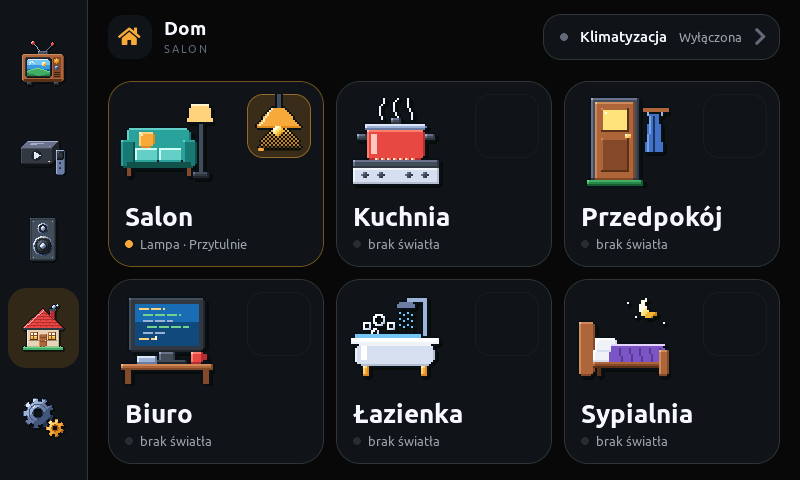
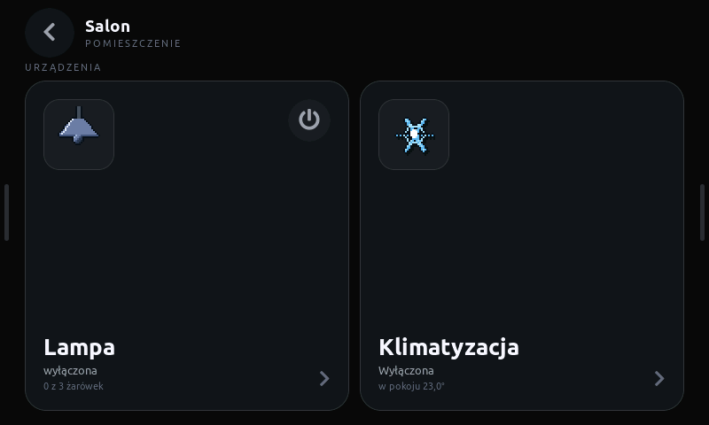
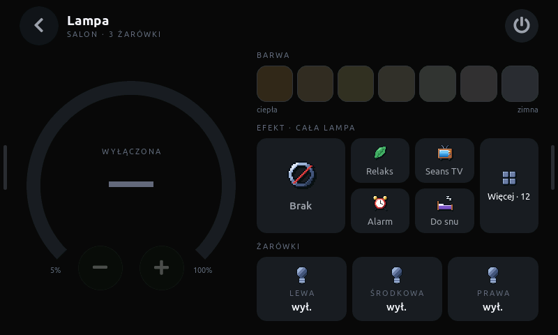
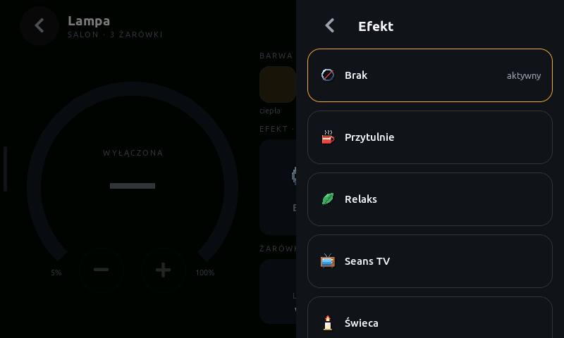
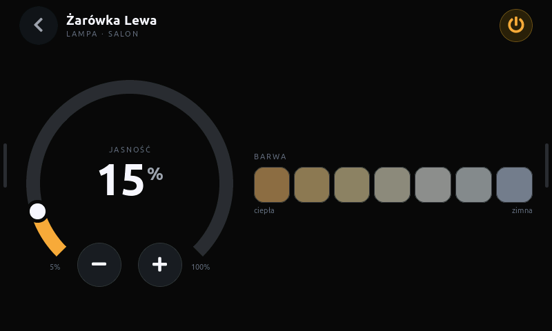
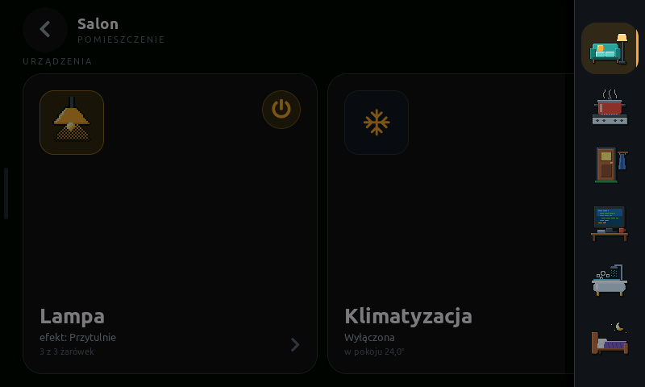
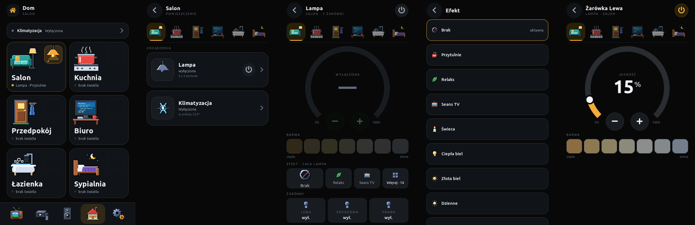
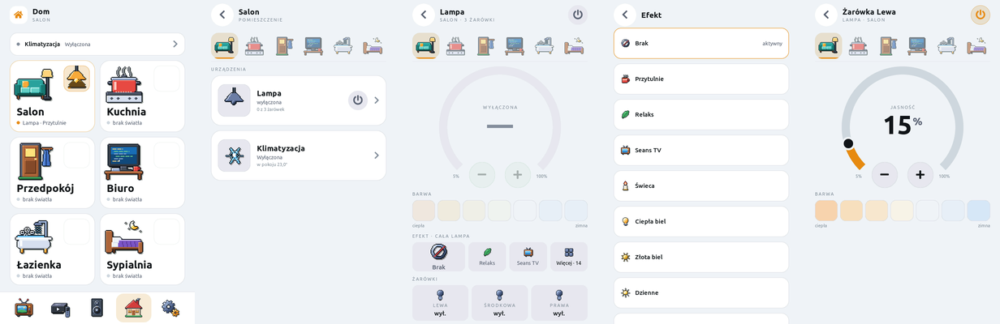

# Standard zakładki Dom

[English](home-screen.en.md)

Zakładka Dom to miejsce na wszystko, co w domu nie jest telewizorem, Apple TV ani
głośnikami: światła, klimatyzacja, a później rolety, czujniki, gniazdka i kolejne
pomieszczenia. Ten dokument jest **standardem**: nowy element zakładki Dom dobiera
wzorce stąd, zamiast wymyślać własne. Decyzje architektoniczne stoją w
[ADR 0014](../architecture/adr/0014-rooms-and-lights.md), format danych w
[kontrakcie MQTT](../architecture/mqtt-contract.md) (sekcja `lights`).

Makiety: [`mockup-pulpit`](mockup-pulpit/index.html) (pion),
[`mockup-landscape`](mockup-landscape/index.html) (poziom), wspólna logika
[`mockup-dom/rooms.js`](mockup-dom/rooms.js) i [`rooms.css`](mockup-dom/rooms.css).
Kod: `components/ui/screens/screen_home.cpp` i `home_*.cpp` (opis plików w [`home_internal.hpp`](../../components/ui/screens/home_internal.hpp)).

| Dom | Pokój | Lampa |
| --- | --- | --- |
|  |  |  |
| **Lista efektów** | **Żarówka** | **Szuflady (poziom)** |
|  |  |  |

Pion (ciemny i jasny):





## 1. Hierarchia

```text
Dom (siatka pomieszczeń)
 └─ Pokój (urządzenia pokoju jako karty)
     └─ Ekran urządzenia (jedno urządzenie: Lampa, Klimatyzacja…)
         ├─ Podurządzenie (żarówka w grupie)
         └─ Lista wyboru (efekt, tryb, bieg…) — nie jest poziomem, tylko wysuwanym panelem
```

- **Dom** zawsze pokazuje wszystkie pomieszczenia, także te bez skonfigurowanych urządzeń.
- **Pokój** pokazuje urządzenia pokoju. Pokój bez urządzeń mówi to wprost (karta „Brak
  encji”), nie znika.
- **Ekran urządzenia** dotyczy jednego urządzenia albo jednej grupy. Tu stoi pełne
  sterowanie.
- **Głębiej niż podurządzenie nie schodzimy.** Wszystko, co jest wyborem z listy, otwiera
  się jako lista wyboru (pkt 4.6), a nie jako kolejny poziom.
- **Wstecz** cofa zawsze o jeden poziom; z pokoju wraca do Domu.

## 2. Reguły

1. **Zasilanie w nagłówku po prawej.** Na ekranie jednego urządzenia przycisk zasilania stoi
   zawsze w prawym górnym rogu nagłówka (jak TV, Z906, Apple TV, klima). Pokój ma kilka
   urządzeń, więc jego nagłówek przycisku nie ma.
2. **Skróty tylko na listach.** Szybkie wł./wył. bez wchodzenia głębiej wolno postawić na
   kafelku pomieszczenia (lampka) i na karcie urządzenia w pokoju. Na ekranie urządzenia
   skrótu nie ma — tam jest zasilanie w nagłówku.
3. **Jeden duży element sterujący, obok kafle.** Ekran urządzenia ma jedną dominującą
   kontrolkę (tarcza jasności, tarcza temperatury) i obok jednolite kafle z resztą opcji.
   W poziomie: kontrolka po lewej (320 px), kafle po prawej. W pionie: kontrolka u góry,
   kafle pod nią. Nic się nie powtarza: nazwa urządzenia jest w nagłówku, nie drugi raz na karcie.
4. **Lista wyboru zamiast kafli, gdy opcji jest dużo.** Ponad siedem opcji albo długie
   nazwy → kafel z bieżącą wartością, a dotknięcie otwiera listę wyboru. **Wybór zamyka
   listę**, oczekiwanie widać na kaflu.
5. **Pilot nie zna encji.** Bridge w Home Assistancie wysyła krótkie identyfikatory
   (`lampa`, `lampa_lewa`), pilot nimi steruje. Nowa encja to zmiana bridge'a, nie firmware'u
   (o ile mieści się w istniejącym typie urządzenia).
6. **Nazwy po polsku dobiera pilot.** Identyfikatory HA (`cool`, `Cozy`) tłumaczy tabela
   w firmware; nieznany identyfikator pokazujemy tak, jak przyszedł — nie chowamy go.
7. **Dotyk nie czeka na sieć.** Po dotknięciu element pokazuje stan oczekujący
   (obwódka), stan zmienia dopiero snapshot z HA. Bez świeżego stanu element jest
   przygaszony i mówi „brak świeżego stanu” / „czekam na stan”, nie zgaduje.
8. **Oba układy.** Każdy nowy ekran ma wersję pionową (480 × 800) i poziomą (800 × 480),
   najpierw w makietach, potem w firmware.
9. **Ikony:** pomieszczenia i urządzenia — pixel art (`tools/draw_room_icons.py`, siatka 48
   albo 32, skala całkowita 1×/2×). Opcje (tryby klimy, efekty lampy) — też pixel art
   (`tools/draw_option_icons.py`, siatka 24: mały kafel i wiersz listy 1×, duży kafel 2×;
   makieta `docs/ux/mockup-option-icons/`), od 2026-11-08 zamiast czcionki Lucide.
10. **Podpisy wersalikami** (`make_cap`), także z polskimi znakami: etykiety z HA przechodzą
    przez `upper_pl` („Środkowa” → „ŚRODKOWA”).

## 3. Układ ekranów

### Dom

- Siatka pomieszczeń: pion 2 × 3, poziom 3 × 2, kafle wypełniają wysokość.
- Klimatyzacja nad siatką: pion — wąski pasek (56 px), poziom — pigułka w nagłówku powłoki.
  Każde nowe urządzenie „dla całego domu” trafia w to samo miejsce (pasek / pigułka), nie
  jako dodatkowy kafel w siatce.

### Pokój

- Nagłówek: Wstecz, nazwa pokoju, podpis `POMIESZCZENIE`.
- Pasek pomieszczeń (ikony 48 px, bez lampek) przełącza pokój bez cofania: w pionie pod
  nagłówkiem, w poziomie w prawej szufladzie.
- Pod etykietą `URZĄDZENIA` karty urządzeń: pion — jedna pod drugą (124 px), poziom — obok
  siebie na pełną wysokość.

### Ekran urządzenia

- Nagłówek: Wstecz, nazwa urządzenia, podpis `POKÓJ · SZCZEGÓŁ` wersalikami, zasilanie po prawej.
- Treść według reguły 3.

### Poziom: szuflady

W pokoju i głębiej treść zajmuje cały ekran 800 × 480. Pasek zakładek i pasek pomieszczeń
są schowane:

- przeciągnięcie od lewej krawędzi (pas 28 px, ruch ≥ 36 px) wysuwa zakładki, od prawej —
  pomieszczenia; dotknięcie pasa przy krawędzi też je wysuwa (uchwyty 5 × 64 px podpowiadają);
- dotknięcie przyciemnionego tła albo przeciągnięcie do krawędzi chowa szufladę;
- wybór pokoju albo zakładki chowa szufladę sam.

## 4. Komponenty

### 4.1 Kafelek pomieszczenia

- Karta `tile`, promień r4. Ikona pomieszczenia 96 px (pixel art 48 × 2) w lewym górnym rogu,
  nazwa `b26` i wiersz stanu (kropka + `r13`) przy dolnej krawędzi.
- **Lampka** w prawym górnym rogu: przycisk 64 × 64, obrazek lampy 64 px w czterech stanach
  (świeci ≥ 50 %, przygaszona, wyłączona, niedostępna) i pasek jasności 3 px u dołu. Tło:
  świeci — akcent 92/255, przygaszona — 46/255, wyłączona — `surface-2`. Pokój bez głównego
  światła: sam obrys.
- Zapalone główne światło: obwódka kafelka w akcencie (opa 110).
- Tekst stanu: `Lampa · 62%`, `Lampa · Przytulnie`, `Lampa · wył.`, `brak światła`,
  `czekam na stan`.

### 4.2 Karta urządzenia w pokoju

- Studzienka 80 px (ikona urządzenia), nazwa, stan, drugi wiersz szczegółu, strzałka.
- Skrót zasilania (reguła 2) tylko dla urządzeń, które go mają (światło).
- Pozycja studzienki i tekstów: pion — rząd, poziom — studzienka u góry, nazwa u dołu.

### 4.3 Tarcza

`widgets::Thermostat`: łuk 270°, duża liczba (`b64num`), podpis nad nią (stan:
`JASNOŚĆ`, `EFEKT`, `WYŁĄCZONA`, tryb klimy), szczegół pod nią, −/+ w przerwie łuku, skala
na końcach. Obrót palcem zmienia wartość względnie, **jedno polecenie na gest** (po puszczeniu
palca albo 0,7 s po ostatnim stuknięciu w −/+). Tryb procentowy: `set_percent()`.

### 4.4 Kafle opcji

- Tło `surface-2`, bez obwódki, promień r2 (14 px).
- Wybrany / aktywny: tło akcentu z kryciem `kAccentSoftOpa` i obwódka 1 px w akcencie,
  tekst w akcencie.
- Podpis wersalikami (`cap`) nad wartością `m15`.
- Rząd kafli dzieli szerokość po równo (np. trzy żarówki, trzy opcje nawiewu).

### 4.5 Próbki barwy

Siedem próbek równo w zakresie `min_kelvin…max_kelvin` encji, stałe kolory od ciepłej do
zimnej. Wybrana: pełne krycie i obwódka 3 px w akcencie; pozostałe przygaszone. W efekcie
i przy wyłączonym świetle wszystkie przygaszone.

### 4.6 Lista wyboru

`widgets::make_page` + `widgets::dock_sheet`: w poziomie panel 380 px przy prawej krawędzi nad
przyciemnionym ekranem, w pionie pełny ekran. Wiersz `make_list_row`: ikona opcji, nazwa,
„aktywny” przy bieżącej, obwódka w akcencie. **Wybór zamyka listę.** Wstecz albo dotknięcie
tła — zamyka bez zmian.

### 4.7 Kafle efektów

Efekt całej lampy to siatka kafli jak tryby klimy (4.4: ikona pixel art nad nazwą, wybrany na
miękkim akcencie z obwódką), nie wiersz z listą. Pierwszy, większy kafel to bieżący efekt
(albo „Brak”); obok najczęściej wybierane efekty tej lampy, przy włączonym efekcie pierwszy
z nich to zawsze „Brak”; ostatni kafel „Więcej · N” otwiera listę wyboru (4.6) ze wszystkimi.
Remis liczników rozstrzyga kolejność `effect_list` z Home Assistanta.

- Poziom: duży kafel przez dwa rzędy po 64 px, 4 efekty i „Więcej” na całą wysokość.
- Pion: pod tarczą 300 px zostaje kilkanaście pikseli, więc jeden rząd 72 px — bieżący
  (szerszy), 2 efekty i „Więcej”. Aplikacja na Androida ma w pionie więcej miejsca i pokazuje
  dwa rzędy (duży, 3 efekty, „Więcej”).
- Liczniki wyborów (kafel i lista) leżą tylko w urządzeniu: panel w NVS (`fx_uses`, skróty
  FNV-1a lampy i efektu), aplikacja w `SettingsStore` (`effect_usage`). Bez tematów MQTT;
  ustawienia fabryczne je kasują.

## 5. Dodawanie

### Nowe światło w pomieszczeniu (bez firmware'u)

1. W bridge'u ([`homeassistant/multimedia_remote.yaml`](../../homeassistant/multimedia_remote.yaml))
   dopisz pozycję w `light_rooms`: `room` (jeden z: `salon`, `kuchnia`, `przedpokoj`, `biuro`,
   `lazienka`, `sypialnia`), `id`, `label`, `entity`, opcjonalnie `members`.
2. Dopisz te encje do wyzwalaczy automatyzacji „Pilot — snapshot po zmianie światła”.
3. Wdróż na serwerze HA: kopia `…before-<zmiana>.<data>`, `check_config`, przeładowanie
   skryptów i automatyzacji.

Limity firmware'u: 3 pomieszczenia ze światłem, 4 żarówki w grupie, 16 efektów.

### Nowy typ urządzenia (np. roleta, termostat pokojowy)

1. ADR: czego potrzebuje ekran, jaka sekcja kontraktu, czy addytywnie w `v1`.
2. Kontrakt: sekcja w snapshocie + akcje, identyfikatory zamiast encji.
3. Bridge: konfiguracja (tabela jak `light_rooms`), snapshot, polecenia, wyzwalacze.
4. Firmware: struktura w `domain/snapshot.hpp`, parsowanie w `transport/ha_client.cpp`,
   `ControlId` i routing w `domain/intent.hpp`, karta w pokoju i ekran urządzenia według
   reguły 3, nazwy po polsku.
5. Makiety (pion i poziom) przed firmware'em; ikona pixel art w `tools/draw_room_icons.py`.
6. Zrzuty (pkt 6) i ten dokument.

### Nowe pomieszczenie

Pomieszczenia są stałą listą w `home_common.cpp` (`kRooms`: identyfikator, nazwa, nazwa
wersalikami, ikony) i w `rooms.js`. Siódme pomieszczenie zmienia siatkę (dziś 6 = 2 × 3 / 3 × 2)
— to decyzja projektowa, nie tylko wpis.

## 6. Zrzuty ekranu

Zakładka Dom ma własny komplet w każdym z czterech katalogów (`docs/screenshots/`,
`light/`, `landscape/`, `landscape/light/`):

| Plik | Ekran |
| --- | --- |
| `05-home.png` | Dom |
| `10-room.png` | Pokój (Salon) |
| `11-light.png` | Lampa |
| `12-effects.png` | Lista efektów |
| `13-bulb.png` | Żarówka |
| `14-drawers.png` | Szuflada pomieszczeń (tylko poziom) |

Robi się je `tools/remote.py` (konsola USB). **Zdalny dotyk naprawdę steruje domem:** przed
każdym stuknięciem sprawdź `hit`, co jest pod palcem, i nie stukaj w zasilanie, tarczę, próbki
ani wiersze listy wyboru. Zrzut nie budzi ekranu — pokazuje ostatnią klatkę; wygaszony ekran
ma na wierzchu warstwę wybudzania, którą `hit` widzi jako obiekt na cały ekran (tak samo
wygląda otwarta podstrona pokoju — najpierw ją zamknij przyciskiem Wstecz). Zbiorcze obrazy
składa `tools/overview.py`.
