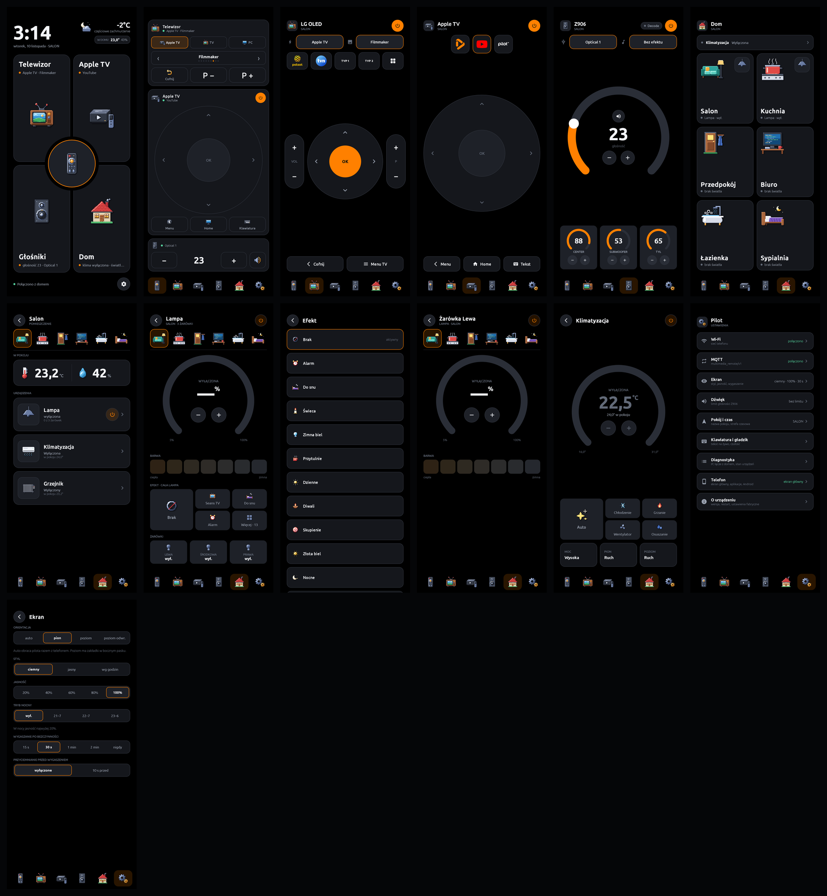
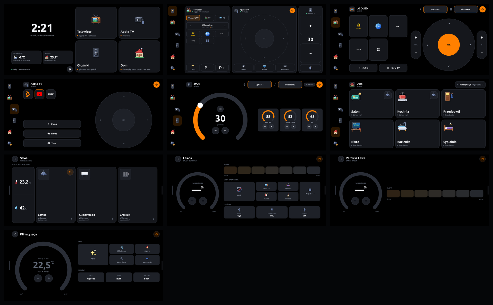
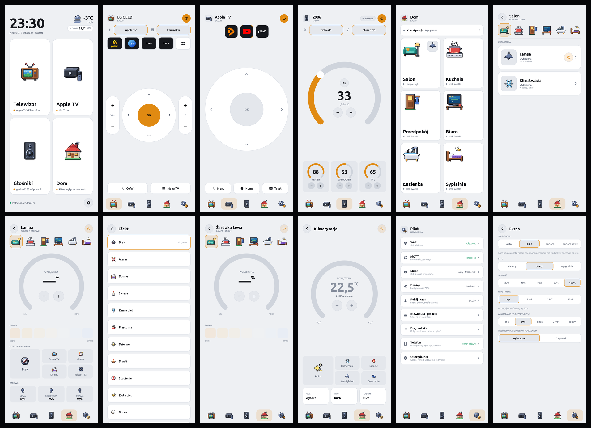
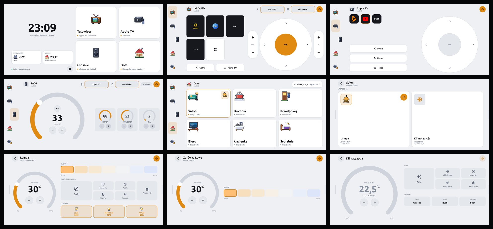

# The remote on a phone

[Polski](README.md)

> Part of the [Couchpad](../README.md) repository: the second version of the remote next to the
> ESP32-P4 panel firmware ([ADR 0016](../docs/architecture/adr/0016-android-app.en.md)).

The Couchpad remote (TV, Apple TV, Logitech Z906, lights and air conditioning through Home
Assistant) as an Android app. Prototype: Galaxy M23 5G; target: Galaxy S5 (Android 6).

The main app is a **native Kotlin + Jetpack Compose app in [`native/`](native/)**. It mirrors
the board firmware's interface and settings (the root of this repository, [`../`](../README.md))
one to one and speaks the same MQTT contract. The firmware does not depend on the app.









All screens: [`docs/screenshots/portrait/`](docs/screenshots/portrait/) and
[`docs/screenshots/landscape/`](docs/screenshots/landscape/) — Start, TV, Apple TV, Z906, Home,
room, lamp, effects, bulb, air conditioning and settings; light theme in the `light/` subfolders.

## What it does

- **Connectivity:** a single MQTT connection. Z906 directly on the controller's topics
  (ADR 0006), the TV directly through Glasshouse (ADR 0008), Apple TV, air conditioning,
  lights, weather and channels through the `multimedia_remote/v1` contract via the HA bridge.
  It reconnects every time it is opened and shows the controls only after a fresh state
  arrives (ADR 0005); in the background it disconnects.
- **Screens as on the board,** in portrait (tabs at the bottom) and landscape (side bar,
  drawers in the Home tab). In landscape the bar fits into the strip next to the front camera.
- **Launcher:** the remote can be the phone's home screen — it starts with the phone, Home
  returns to the start screen, and when the screen turns on the remote shows up at once,
  above the lock screen (no swipe needed without a PIN), always on the start screen
  (ADR 0010). Set it in *Settings → Phone → Set as home screen*; the phone's app list and the
  way into Android settings are there too.
- **OLED style** (app only): *Settings → Phone → Dark style on this phone*. Cards and
  controls are black inside with an outline only, dimmer text and a soft accent on large
  areas — for OLED/AMOLED screens; keep standard on LCD. The remote enforces the brightness
  from *Settings → Display → Brightness*, so set it lower on OLED (40–60%)
  ([ADR 0019](../docs/architecture/adr/0019-phone-oled-style.en.md)).
- **Wi-Fi updates:** after `phone/tools/publish-update.sh` on the laptop every phone shows
  "Install version …" in *Settings → Phone*; it downloads the APK from Home Assistant, checks
  the checksum and installs it. On Android 12+ without a confirmation dialog (Samsung), on
  Xiaomi (HyperOS) with one confirmation. The first time, the remote needs permission to
  install apps; Play Protect or the vendor's scanner may ask for a decision on a new version.
  The remote comes back by itself after an update only as the home screen
  ([ADR 0021](../docs/architecture/adr/0021-phone-wifi-updates.en.md)).
- **Settings 1:1:** MQTT (empty identifiers are discovered automatically), display
  (orientation, theme, brightness, night mode, screen timeout), sound, room and time,
  keyboard and trackpad, diagnostics.

## Build and install

Requires JDK 17 (`brew install openjdk@17`) and the Android SDK with `platforms;android-35`,
`build-tools;34.0.0`. The version number is the commit count (`versionCode`, `0.3.<n>`).

```bash
cd native
export JAVA_HOME=$(brew --prefix openjdk@17)/libexec/openjdk.jdk/Contents/Home
echo "sdk.dir=$HOME/Library/Android/sdk" > local.properties
./gradlew assembleDebug
adb push app/build/outputs/apk/debug/app-debug.apk /data/local/tmp/pilot.apk
adb shell pm install -r -i app.couchpad.pilot /data/local/tmp/pilot.apk
adb shell am start -n app.couchpad.pilot/.MainActivity
./gradlew testDebugUnitTest   # logic tests without a phone
```

`-i app.couchpad.pilot` keeps the remote as its own installer — a plain `adb install` resets it
and the next Wi-Fi update shows the confirmation dialog again.

Release for the phones at home over Wi-Fi (after a commit; configuration in `tools/update.env`
outside git, template `tools/update.env.example`):

```bash
tools/publish-update.sh
```

Broker details are entered on the phone (Settings → MQTT). They never reach the repository.

Screenshots from a connected phone: `tools/screenshots.sh portrait|landscape [light]`
(with `light` in the light theme, into `docs/screenshots/<orientation>/light/`).

## LVGL port (reference)

The first version ran the firmware's LVGL code through SDL2: `compat/` (ESP-IDF and FreeRTOS
on system threads, NVS in a file, an MQTT client with the esp-mqtt API), `platform/` and
`android/`. It also works as a simulator on a Mac (`cmake -S . -B build/sim && cmake --build build/sim`),
but the 480 × 800 image scaled up on the phone was blurry, so the native app is what we develop.

Work status and next steps (in Polish): [`docs/PROGRESS.md`](docs/PROGRESS.md).
