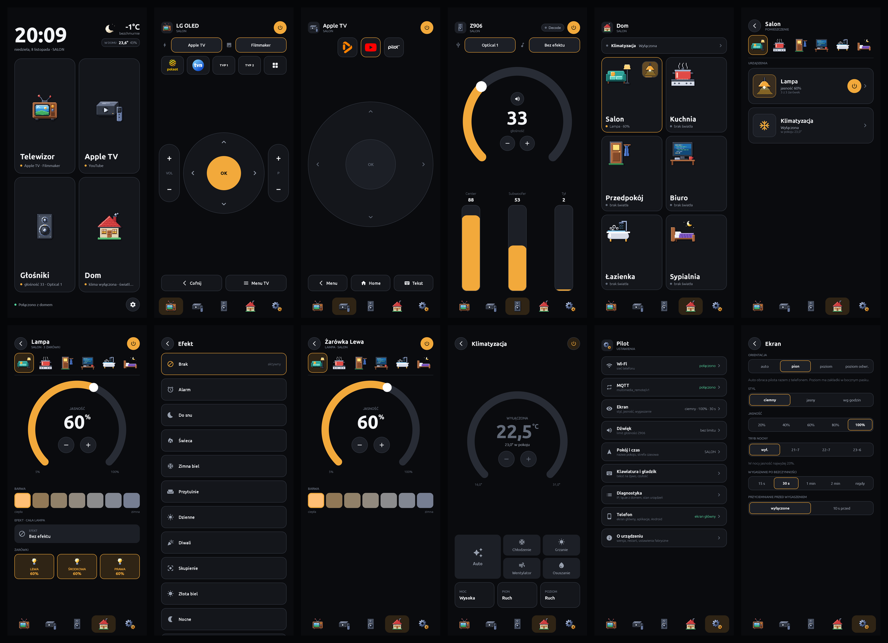
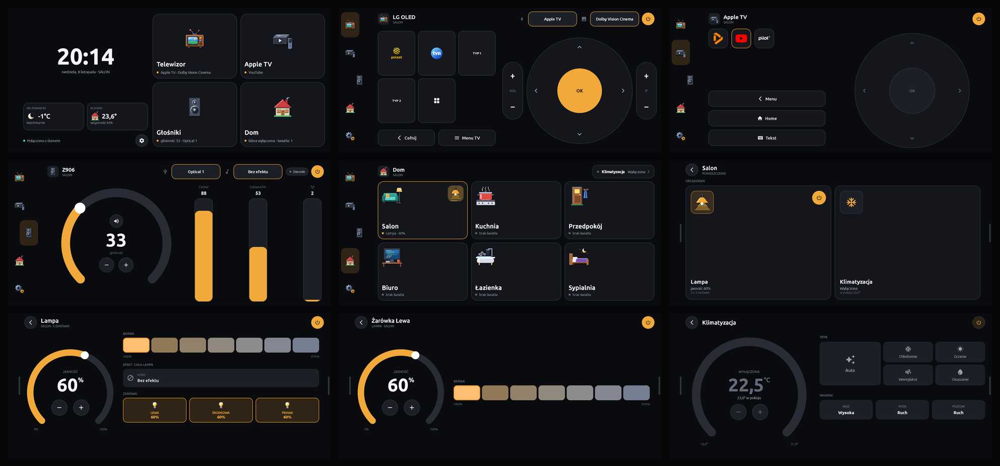
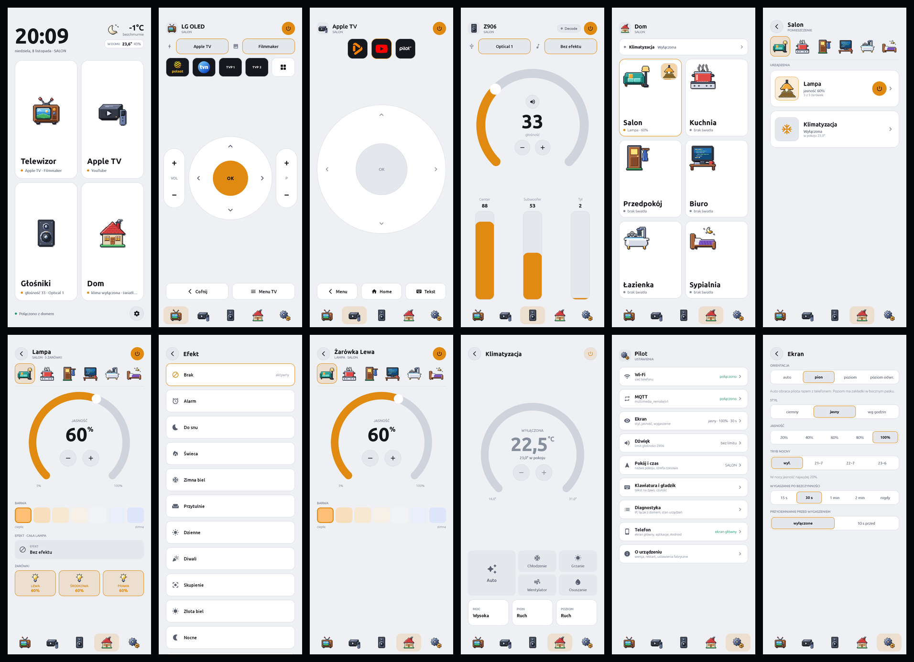
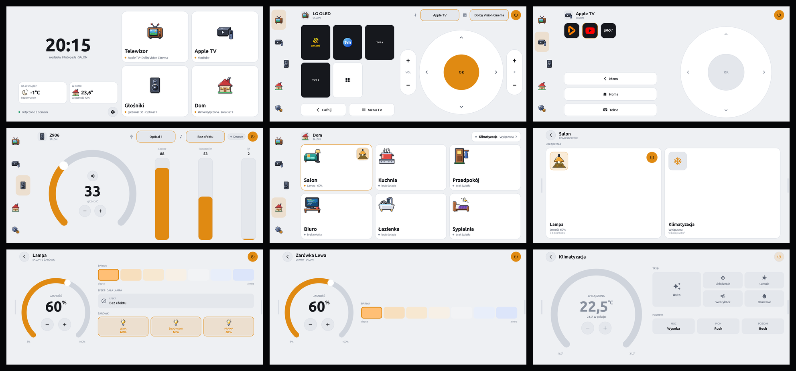

# Pilot na telefonie

[English](README.en.md)

Pilot Couchpad (TV, Apple TV, Logitech Z906, światła i klimatyzacja przez Home Assistanta)
jako aplikacja na Androida. Prototyp: Galaxy M23 5G, docelowo Galaxy S5 (Android 6).

Aplikacja główna to **natywna aplikacja Kotlin + Jetpack Compose w [`native/`](native/)**.
Odwzorowuje 1:1 interfejs i ustawienia firmware'u płytki (`../firmware`) i mówi tym samym
kontraktem MQTT. Firmware nie jest przez to repozytorium zmieniany.









Wszystkie ekrany: [`docs/screenshots/portrait/`](docs/screenshots/portrait/) i
[`docs/screenshots/landscape/`](docs/screenshots/landscape/) — Start, TV, Apple TV, Z906, Dom,
pokój, lampa, efekty, żarówka, klimatyzacja i ustawienia; w stylu jasnym w podkatalogach `light/`.

## Co robi

- **Łączność:** jedno połączenie MQTT. Z906 wprost na tematach kontrolera (ADR 0006),
  telewizor wprost przez Glasshouse (ADR 0008), Apple TV, klima, światła, pogoda i kanały
  kontraktem `multimedia_remote/v1` przez bridge HA. Po każdym otwarciu łączy się od nowa
  i pokazuje sterowanie dopiero po świeżym stanie (ADR 0005); w tle się rozłącza.
- **Ekrany jak na płytce,** w pionie (zakładki na dole) i w poziomie (boczny pasek, szuflady
  w zakładce Dom). W poziomie pasek wchodzi w pas obok przedniej kamery.
- **Launcher:** pilot może być ekranem głównym telefonu — startuje razem z nim, Home wraca
  na ekran startowy, a po zapaleniu ekranu pilot pokazuje się od razu, nad ekranem blokady
  (bez PIN-u nie trzeba go przesuwać), zawsze na ekranie startowym (ADR 0010). Ustawia się
  go w *Ustawienia → Telefon → Ustaw jako ekran główny*; tam też lista aplikacji telefonu
  i wejście do ustawień Androida.
- **Ustawienia 1:1:** MQTT (puste identyfikatory wykrywa sam), ekran (orientacja, styl,
  jasność, tryb nocny, wygaszanie), dźwięk, pokój i czas, klawiatura i gładzik, diagnostyka.

## Budowa i instalacja

Wymaga JDK 17 (`brew install openjdk@17`) i Android SDK z `platforms;android-34`,
`build-tools;34.0.0`.

```bash
cd native
export JAVA_HOME=$(brew --prefix openjdk@17)/libexec/openjdk.jdk/Contents/Home
echo "sdk.dir=$HOME/Library/Android/sdk" > local.properties
./gradlew assembleDebug
adb install -r app/build/outputs/apk/debug/app-debug.apk
./gradlew testDebugUnitTest   # testy logiki bez telefonu
```

Dane brokera wpisuje się na telefonie (Ustawienia → MQTT). Nie trafiają do repozytorium.

Zrzuty ekranu z podłączonego telefonu: `tools/screenshots.sh portrait|landscape [light]`
(z `light` w stylu jasnym, do `docs/screenshots/<orientacja>/light/`).

## Port LVGL (referencja)

Pierwsza wersja uruchamiała kod LVGL firmware'u przez SDL2: `compat/` (ESP-IDF i FreeRTOS
na wątkach systemu, NVS w pliku, klient MQTT z API esp-mqtt), `platform/` i `android/`.
Działa także jako symulator na Macu (`cmake -S . -B build/sim && cmake --build build/sim`),
ale obraz 480 × 800 skalowany na telefonie był rozmyty, więc rozwijamy aplikację natywną.

Stan prac i kolejne kroki: [`docs/PROGRESS.md`](docs/PROGRESS.md).
